# Can Kickstarter Success Be Predicted at Launch?

## Logistic regression in Alteryx using only information available before a campaign begins

**Project question:** *Can we predict whether a Kickstarter campaign will achieve its funding goal using only information available when it launches?*

I used Alteryx to analyse 138,189 completed Kickstarter campaigns and investigate whether characteristics such as funding goal, campaign duration, preparation time, project category and text length could help predict success.

Two logistic regression models were developed and compared before the selected model was evaluated on campaigns launched from January 2025 onwards.

**Key results:**

- The final model achieved **79.6% accuracy**, compared with a 73.5% baseline from predicting that every campaign would succeed.

- It correctly identified **93.3% of successful campaigns**, but only **41.6% of failed campaigns**.

- Funding goal, preparation time, campaign duration, title length and project category were among the characteristics associated with success.

The project follows the complete analytical process, from preparing the raw data and preventing target leakage through to exploratory analysis, model development and evaluation.

The objective was to develop an interpretable model that could help explain historical relationships, rather than simply maximise predictive accuracy.

---

## Contents

1. [Project framing](#project-framing)
2. [Data source and scope](#data-source-and-scope)
3. [Data preparation](#data-preparation-and-leakage-control)
4. [Feature engineering](#feature-engineering)
5. [Train/test design](#traintest-design)
6. [Exploratory data analysis](#exploratory-data-analysis)
7. [Model design](#model-design)
8. [Cross-validation and model selection](#cross-validation-and-model-selection)
9. [Final model evaluation](#final-model-evaluation)
10. [Interpreting the selected model](#interpreting-the-selected-model)
11. [Limitations](#limitations)
12. [Future development](#future-development)
13. [Conclusion](#conclusion)

---

## Project framing

The outcome of each campaign was classified as either successful (1) or failed (0), making this a binary classification problem.

I chose logistic regression because it is suitable for binary classification and produces interpretable coefficients and odds ratios. This allows me to understand which campaign characteristics are associated with success, rather than simply generating predictions.

---

## Data source and scope

The data came from the public **Web Robots Kickstarter dataset**:

https://webrobots.io/kickstarter-datasets/

Web Robots publishes monthly Kickstarter scrapes in CSV and JSON formats. I used the **10 September 2026 CSV snapshot** rather than combining multiple monthly snapshots.

### Primary modelling population

Only campaigns with a known final outcome were used for the main model:

- `successful` -> `1`
- `failed` -> `0`

Projects that were live, submitted, started, cancelled or lacked the specific successful/failed outcome required by the primary question were excluded from the main modelling population.

After filtering, validation and deduplication, the dataset contained **138,189 completed campaigns**:

- **92,208 successful**
- **45,981 failed**

The unit of analysis is one Kickstarter campaign.

---

## Data preparation and leakage control

A substantial part of the project was designing a modelling dataset that could realistically have existed **at launch**.

### 1. Load and combine the source files

I used Alteryx to combine the CSV files into one dataset. The process uses Directory and Dynamic Input tools, allowing the same workflow to be used if the source files are updated.

### 2. Remove clearly post-launch information

Fields that directly or indirectly reveal how the campaign performed were removed from the predictor stream. Examples include:

- pledged amount
- USD pledged amount
- converted pledged amount
- percentage funded
- number of backers
- spotlight status
- state-change timing

Including these fields would create **target leakage** because they are only known during or after campaign performance unfolds. A model containing them might look extremely accurate while being useless for a genuine launch-time prediction.

### 3. Keep launched, completed campaigns only

The workflow applies the outcome filters described above, ensuring that only launched campaigns with a successful or failed outcome enter the modelling dataset.

### 4. Convert Unix timestamps and enforce date logic

The raw timestamp fields were converted into readable dates for:

- project creation
- launch
- funding deadline

A QA rule requires:

`Created date <= Launch date <= Deadline date`

This makes the chronology explicit and prevents invalid sequences entering the feature calculations.

### 5. Investigate and remove duplicates

The source data contained some repeated Kickstarter project IDs. I checked these records before removing duplicates, ensuring each campaign was represented only once in the modelling dataset.

### 6. Investigate nested fields

Some information in the source data was stored within nested JSON fields rather than individual columns. These included details about the project category, creator, location and video content.

I investigated these fields to identify whether they contained useful information for predicting success.

Category information was retained because it provided a clear and interpretable way of comparing different types of projects.

The additional creator, location and video details were not included in the final model because they were either too detailed for the scope of the project or could not be confidently treated as reliable information available at launch.

### 7. Parent category clean-up

Some campaigns had no recorded parent category because their existing category was already one of Kickstarter's top-level categories.

I investigated these records and completed the parent-category field where appropriate, ensuring campaigns could be grouped consistently for analysis and modelling.

### 8. Final data-quality checks

Before modelling, I carried out a final set of checks to ensure the data were suitable for analysis.

These included checking that:

- Funding goals were greater than zero.
- Campaign durations were positive.
- Preparation time was not negative.
- Each campaign had a valid success or failure outcome.
- Category and country information were available.

These checks helped prevent invalid or incomplete records from entering the model. I also kept them within the Alteryx workflow so the same rules could be applied if the dataset was updated in future.

---

## Feature engineering

The workflow creates a small set of features that can be understood by a non-technical reader and are available at launch.

### Funding goal

`Goal_USD = goal x static_usd_rate`

The raw goal was converted to USD so that goals from different currencies could be placed on a common scale.

A second field was then created:

`Log10_Goal_USD = log10(Goal_USD)`

Funding goals varied considerably, so I applied a log10 transformation to reduce the influence of extreme values. This also provides a useful interpretation: a one-unit increase in Log10_Goal_USD represents a tenfold increase in the funding goal. The original and transformed distributions are compared in the EDA.

### Campaign timing

- `Campaign_Duration_Days = deadline - launch date`
- `Preparation_Days = launch date - creation date`
- launch month
- launch weekday
- launch year

Launch year was used for the chronological split and analysis of changes over time, not as a predictor in the final model.

### Text length

- title word count
- blurb word count

The objective was to test whether title and blurb length were related to campaign success.

### Country grouping

Country frequency was calculated from the **training data only**. Countries with fewer than **300 training campaigns** were grouped into `Other`.

The resulting training-derived mapping was then applied unchanged to the test period. A country appearing in Test without an established training category was also mapped to `Other` rather than creating a new unseen model level.

### One-hot encoding

Categorical variables and EDA-defined bands were converted into indicator fields in Alteryx before logistic regression. One category from each field was omitted as the reference level.

---

## Train/test design

The project uses a **chronological Train/Test split**, not a random split. Campaigns launched up to the end of 2024 were used to develop and compare the models, while campaigns launched from January 2025 onwards were reserved for final testing.

| Dataset | Period | Campaigns | Split | Success rate |
|---|---|---:|---:|---:|
| Train | Launch through 31 Dec 2024 | 108,393 | 78.4% | 64.9% |
| Test | Launch from 1 Jan 2025 | 29,796 | 21.6% | 73.5% |

I chose this approach because the objective was to predict outcomes for later campaigns, rather than evaluate a model on a random mixture of older and newer projects.

An important finding was that the success rate increased from 64.9% in the training data to 73.5% in the test data. This difference also meant I needed to assess performance using more than accuracy alone.

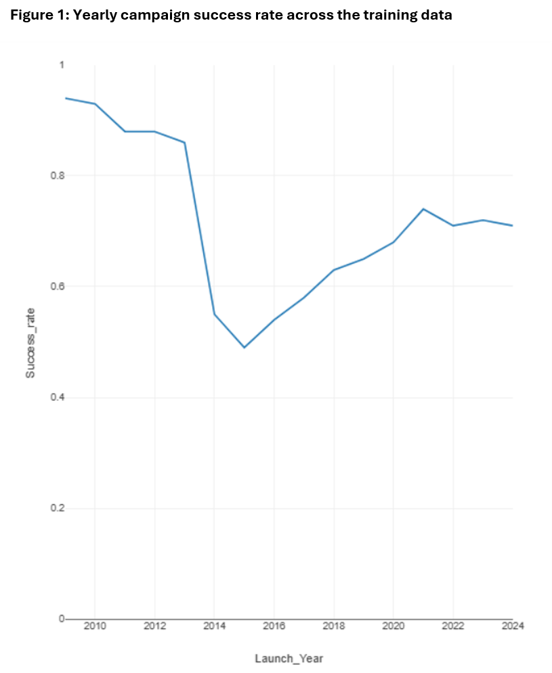

All EDA and modelling decisions, including band definitions, country grouping and model selection, were based on Train only. The Test set was reserved for final evaluation after the model specification had been fixed.

---

## Exploratory data analysis

EDA was used to decide **how variables should enter the model**, not simply to produce descriptive charts. The main questions were:

- Is the variable strongly skewed?
- Does the relationship with success appear linear or non-linear?
- Are categories well populated?
- Does the variable provide a plausible launch-time signal?

### Target balance

Successful campaigns made up the majority of the training data, meaning that accuracy alone could provide a misleading impression of model performance. I therefore used additional measures, including AUC, F1-score and recall for each outcome, to assess the models more thoroughly.

### Funding goal: raw vs log scale

The funding-goal distribution is highly skewed:

- median training goal: approximately **$4,000**
- mean: approximately **$29,529**
- 95th percentile: **$50,000**
- 99th percentile: **$200,000**
- maximum: more than **$100 million**

Figure 2 shows how strongly the raw funding goals are skewed, with a small number of very large campaigns. The log10 transformation reduces the heavy skew and compresses the extreme values, making the funding goal easier to represent in the regression model.

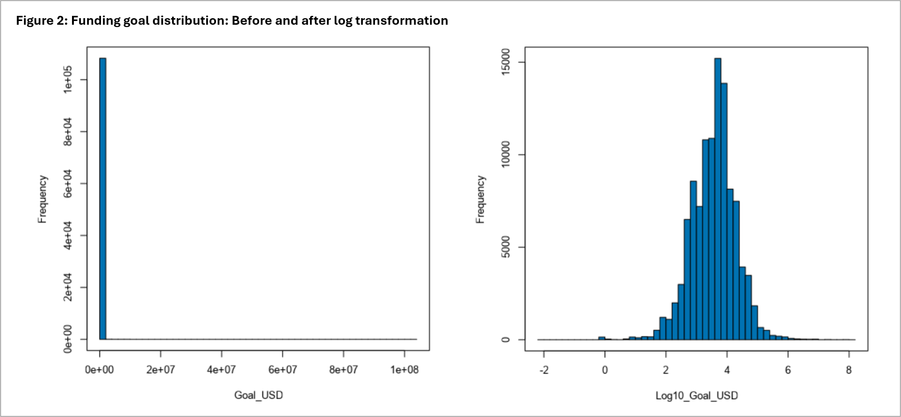

**Decision:** use `Log10_Goal_USD` rather than raw `Goal_USD`.

### Campaign duration

Duration is not distributed smoothly. Around **43,600 training campaigns run for exactly 30 days**, with another strong concentration at 60 days.

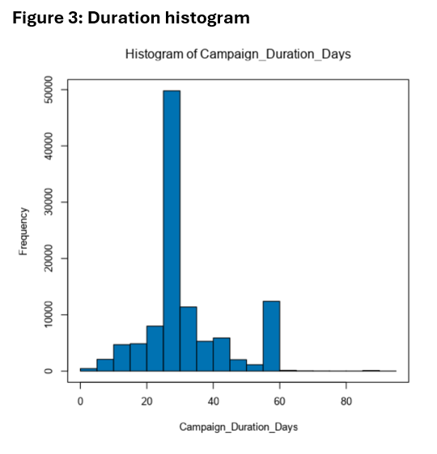

Observed success was also non-linear:

| Duration | Training campaigns | Success rate |
|---|---:|---:|
| 1-14 days | 5,383 | 74.6% |
| 15-29 days | 20,915 | 76.6% |
| 30 days | 43,600 | 61.9% |
| 31-44 days | 18,561 | 72.8% |
| 45-59 days | 8,526 | 57.0% |
| 60+ days | 11,408 | 42.8% |

**Decision:** I grouped campaign duration into bands rather than treating it as a continuous variable, because the relationship with success was not consistent across durations. I used 30 days as the reference group because it was the most common campaign length.

### Preparation time

Preparation time is heavily right-skewed. In Train:

- median = **13 days**
- 90th percentile = **105 days**
- 99th percentile = about **650 days**
- maximum = more than **3,900 days**

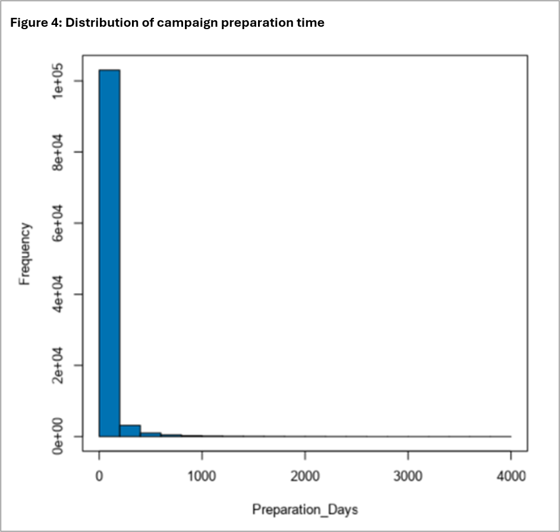

The relationship with success is clearly non-linear. Success rises through the early preparation bands, peaks in the 31-106 day group, then falls slightly for the longest-preparation campaigns.

| Preparation time | Success rate |
|---|---:|
| 0-1 day | 45.8% |
| 2-5 days | 57.0% |
| 6-13 days | 68.0% |
| 14-30 days | 72.7% |
| 31-106 days | 73.6% |
| 107+ days | 68.2% |

**Decision:** use preparation-time bands, with **31-106 days as the reference group**.

### Title length

Title length showed a comparatively smooth positive relationship with success. For example, the observed success rate rose from approximately **56% for 1-3 word titles** to around **73% for 10-12 words**.

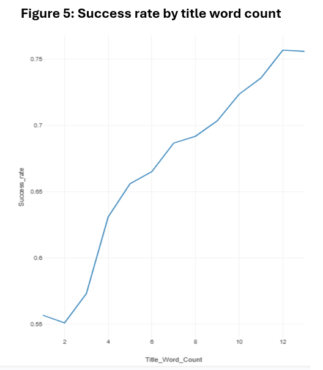

The relationship was smooth enough to keep title length as a single numeric predictor.

**Decision:** use `Title_Word_Count` as a numeric predictor.

### Blurb length

Blurb length showed an inverted-U pattern rather than a linear relationship.

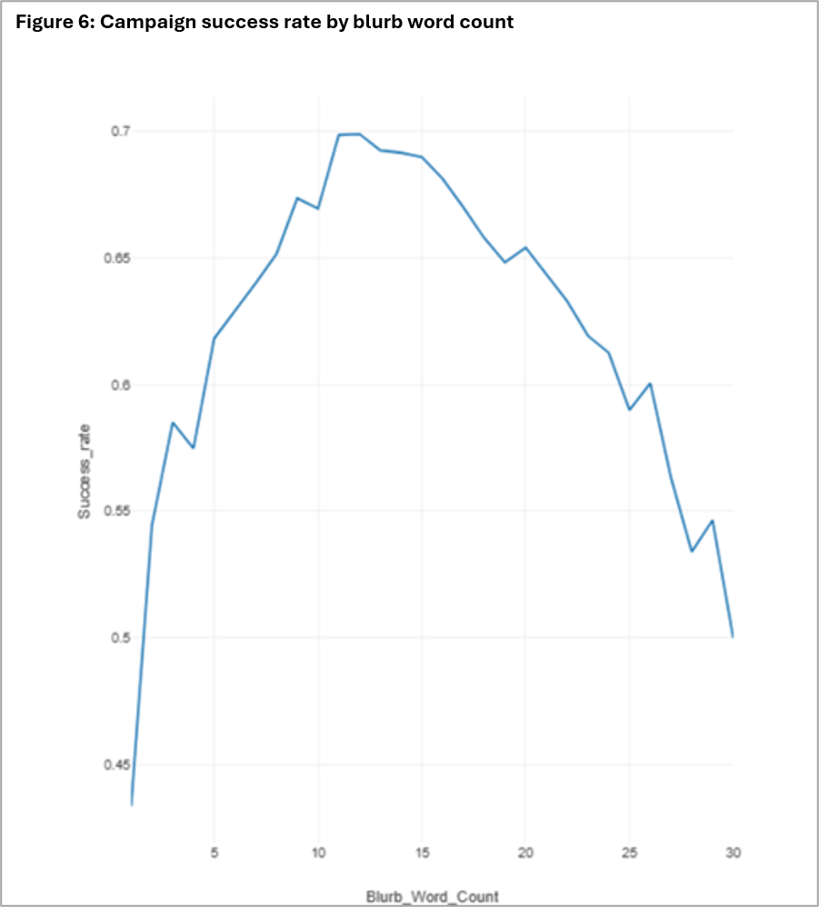

| Blurb length | Success rate |
|---|---:|
| 1-5 words | 58.7% |
| 6-10 words | 65.5% |
| 11-15 words | 69.4% |
| 16-20 words | 66.0% |
| 21-25 words | 62.5% |
| 26-29 words | 57.9% |
| 30+ words | 53.5% |

**Decision:** use blurb-length bands, with **16-20 words as the reference group**.

### Parent category

Success rates varied meaningfully across the 15 parent categories in the training data. Film & Video, Dance, Music and Art were among the higher observed rates, while Fashion, Food and Journalism were much lower.

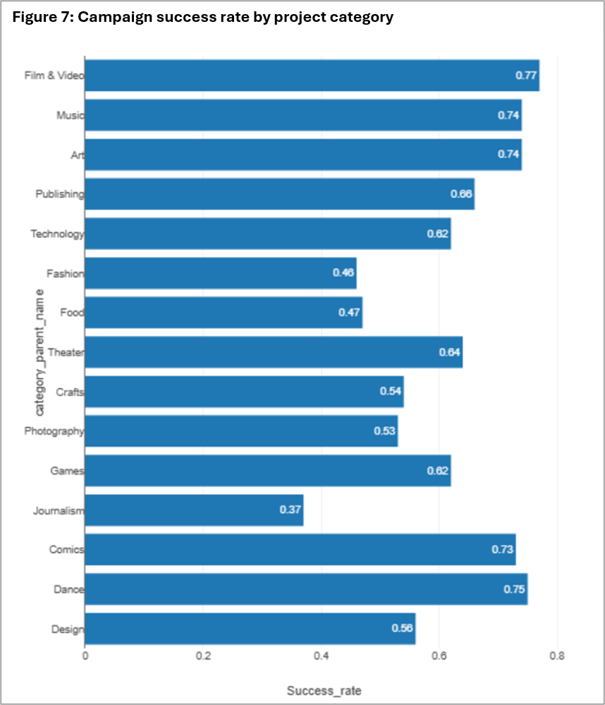

The variation is large enough to justify including parent category as a categorical predictor in the multivariable model.

### Country, launch month and weekday

Country and launch timing showed differences in observed success rates. Launch month and weekday were retained as categorical predictors because they could provide additional information about the timing of a campaign.

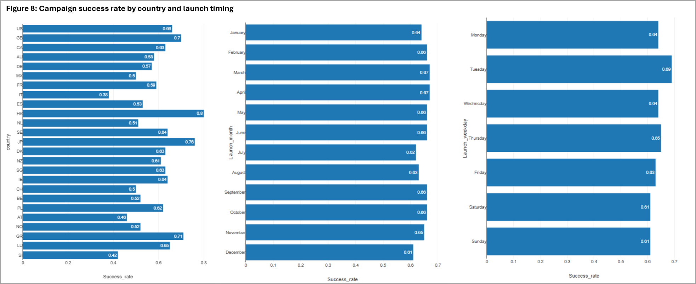

### Correlation checks

Numeric candidate fields were checked for obvious pairwise correlation problems. No issue was large enough to require removing a final numeric predictor. The main transformation decisions came from distribution shape and the relationship with success rather than from correlation alone.

---

## Model design

Two logistic-regression iterations were developed using the same training data.

### Core model

The Core model represents information about the campaign design and launch context:

- Log10_Goal_USD
- duration band
- parent category
- country
- launch month
- launch weekday

### Expanded model

The Expanded model contains all Core predictors plus three additional features related to preparation and presentation:

- preparation-time band
- title word count
- blurb-length band

The purpose of the comparison was simple: **do these additional variables add enough predictive value to justify the extra complexity?**

### Stepwise robustness check

I also tested stepwise AIC versions of both models to see whether a simpler model could achieve similar results. The Expanded stepwise model removed a small number of weaker country and month indicators, but its predictive performance and coefficient estimates were almost unchanged. I therefore retained the full Expanded model.

---

## Cross-validation and model selection

To compare the models fairly, I used repeated five-fold cross-validation on the training data. The training data was split into five parts, with the model built using four parts and assessed on the remaining part. This was repeated so that each part was used for assessment, and the full process was repeated across three trials.

| Metric | Core | Expanded | Improvement |
|---|---:|---:|---:|
| Accuracy | 0.7149 | **0.7425** | +0.0276 |
| AUC | 0.7288 | **0.7697** | +0.0409 |
| F1 | 0.8010 | **0.8167** | +0.0157 |
| Failure recall | 0.4042 | **0.4833** | +0.0791 |
| Success recall | **0.8821** | 0.8820 | effectively unchanged |

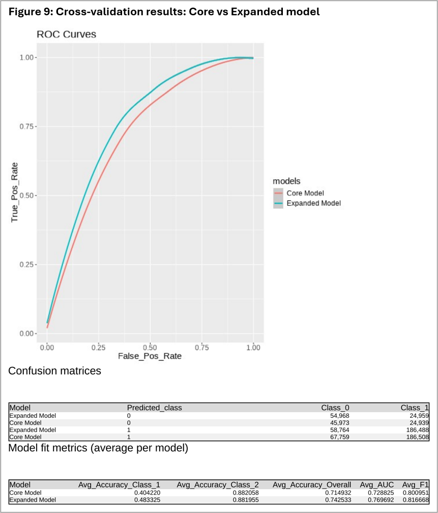

The Expanded model performed better in cross-validation, improving accuracy, AUC and F1-score compared with the Core model.

The most important improvement was in failure recall, which increased by approximately 7.9 percentage points, while success recall remained almost unchanged.

This suggested that adding preparation time and campaign text-length information helped the model identify more failed campaigns without substantially reducing its ability to identify successful ones.

I therefore selected the full Expanded model for final testing on later campaigns.

---

## Final model evaluation

The selected Expanded model was evaluated on 29,796 campaigns launched from January 2025 onwards. These campaigns had not been used during model development or selection.

### Test-set performance

| Metric | Test result |
|---|---:|
| Accuracy | **79.60%** |
| AUC | **0.7966** |
| F1 | **0.8705** |
| Failure recall | **41.61%** |
| Success recall | **93.32%** |
| Majority-class baseline accuracy | **73.5%** |

The model correctly classified approximately eight out of ten campaigns, achieving 79.6% accuracy.

However, as 73.5% of the test campaigns were successful, a model that simply predicted success for every campaign would already achieve 73.5% accuracy.

The logistic regression model therefore improved accuracy by **6.1 percentage points** over this simple baseline.

### Performance by campaign outcome

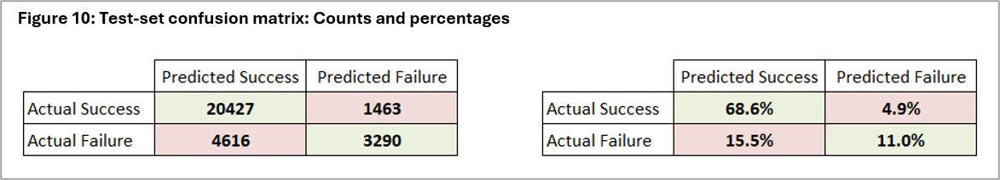

The confusion matrix shows that the model performed considerably better at identifying successful campaigns than failed campaigns.

It correctly identified **93.3% of successful campaigns**, but only **41.6%** of failed campaigns.

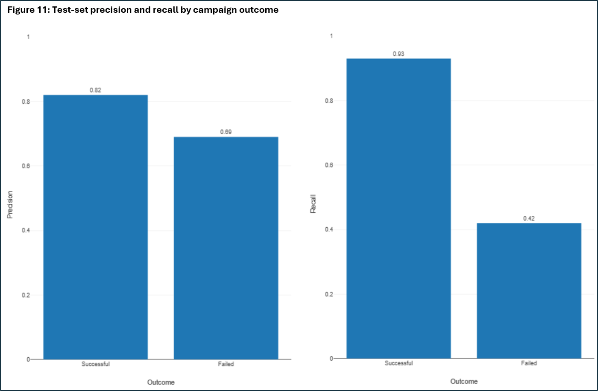

Figure 11 provides a more detailed comparison of performance across the two outcomes.

Precision shows how often predictions for each outcome were correct, while recall shows what proportion of actual campaigns in each class the model identified.

The main limitation was the relatively low recall for failed campaigns, meaning the model missed a substantial proportion of projects that ultimately failed.

### Ability to distinguish between outcomes

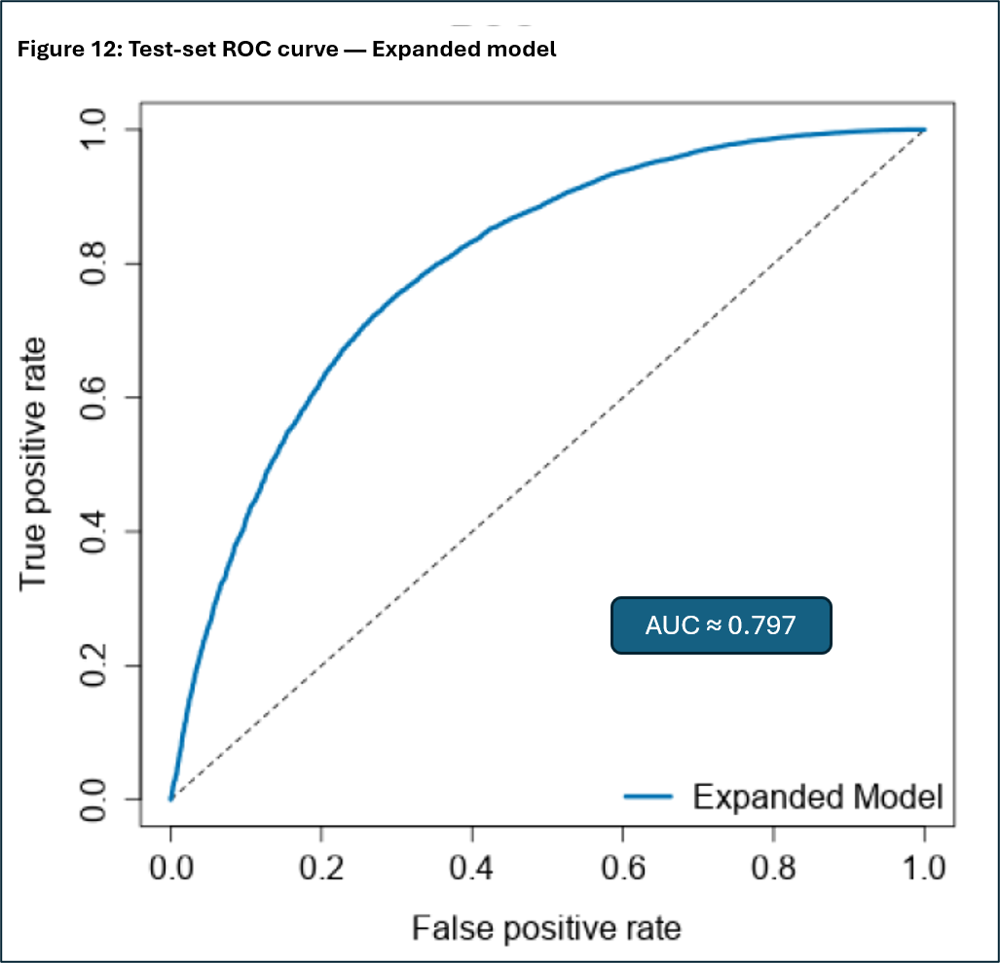

The model achieved an AUC of 0.797, indicating a useful ability to distinguish between campaigns with higher and lower likelihoods of success across different classification thresholds.

This supports the finding that information available at launch contains predictive value, although the model's performance is not equally strong for both outcomes.

---

## Interpreting the selected model

One of the advantages of logistic regression is that it allows us to understand how different campaign characteristics are associated with success, rather than simply producing a prediction.

I converted the model coefficients into odds ratios using `exp(coefficient)`. An **odds ratio** above 1 indicates higher odds of success, while a value below 1 indicates lower odds, holding the other variables in the model constant.

The table below highlights seven selected predictors from the Expanded model, using the training data.

| Predictor / comparison | Odds ratio | Interpretation |
|---|---:|---|
| Tenfold increase in funding goal | **0.383** | Approximately 62% lower odds of success |
| Preparation time: 0–1 vs 31–106 days | **0.205** | Approximately 80% lower odds |
| Duration: 15–29 vs 30 days | **1.786** | Approximately 79% higher odds |
| Duration: 60+ vs 30 days | **0.528** | Approximately 47% lower odds |
| One additional title word | **1.100** | Approximately 10% higher odds per word |
| Blurb length: 21–25 vs 16–20 words | **0.791** | Approximately 21% lower odds |
| Fashion category vs Film & Video | **0.153** | Approximately 85% lower odds |

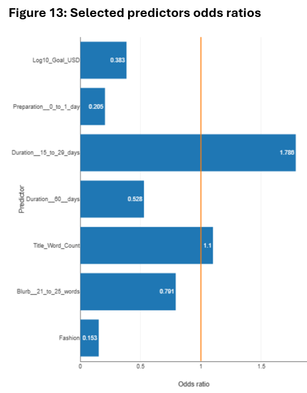

The orange reference line represents an odds ratio of 1.0, indicating no difference in odds.

These are selected examples rather than a complete list of model coefficients. They illustrate some of the more interesting relationships identified in the analysis.

### Funding goals and preparation time

Larger funding goals were associated with lower odds of success, even after accounting for the other campaign characteristics. Campaigns launched within one day of being created also had substantially lower odds than those with longer preparation periods.

This suggests that both the scale of the funding target and the time spent preparing a campaign contain useful predictive information. However, the results do not prove that reducing a funding goal or delaying a launch would directly improve a project's chances of success.

### Campaign duration

The relationship between duration and success was not straightforward. Campaigns running for 15–29 days had higher odds of success than 30-day campaigns, while those lasting 60 days or more had considerably lower odds.

This suggests that allowing more time to raise funds is not necessarily associated with a better outcome.

### Campaign presentation

Title length had a positive relationship with success, with each additional word associated with approximately 10% higher odds within the observed range.

Blurb length showed a more varied pattern. For example, campaigns with 21–25 words had lower odds of success than those with 16–20 words, suggesting that longer descriptions are not necessarily associated with better outcomes.

### Project category

The model also identified differences between project categories. Fashion campaigns had substantially lower odds of success than Film & Video campaigns, after accounting for the other predictors.

These findings reflect statistical associations rather than evidence of causation. They show which characteristics were related to success after accounting for the other predictors, but do not prove that changing them would directly improve a campaign's outcome.

---

## Limitations

### Limits of the source data

The analysis uses a public Web Robots dataset rather than a controlled random sample. The results should therefore be interpreted within the available data rather than treated as exact estimates for all Kickstarter activity.

Only campaigns with a recorded successful or failed outcome were included. As a result, some recently launched campaigns may have been excluded because their funding period had not yet finished or their outcome had not been recorded.

This means the later-period test dataset may not fully represent all campaigns launched during that period.

### Changes over time

The proportion of successful campaigns was higher in the test period than in the training data, showing that the balance of campaign outcomes changed over time.

Although the model demonstrated useful predictive performance on later campaigns, this does not guarantee that its performance will remain consistent in future periods.

Further validation would be needed before using the model routinely.

### Identifying failed campaigns

The model was considerably better at identifying successful campaigns than failed campaigns.

Its weaker failure recall means that it should not be used as a reliable way of rejecting campaigns expected to fail. Some potentially unsuccessful campaigns would still be classified as successful.

### Available predictors

The model uses a deliberately limited set of launch-time characteristics. Other information, such as creator history, the meaning of campaign text, imagery or promotional activity available at launch, could provide additional predictive value.

These were outside the scope of the current analysis. Post-launch performance information was deliberately excluded to prevent target leakage.

---

## Future development

The project could be extended in several directions without changing the core workflow:

1. **Validate on later campaigns**: Evaluate the model on another group of campaigns once their outcomes are known, to assess whether predictive performance remains stable over time.
2. **Monitor changes in campaign characteristics**: Examine shifts in country mix, project categories, funding goals and overall success rates.
3. **Investigate classification thresholds**: Assess whether an alternative threshold could improve the model's ability to identify failed campaigns, using separate validation data rather than the final Test set.
4. **Introduce creator history**: Investigate whether information about a creator's previous projects improves predictions, using only information available before each campaign launches.
5. **Explore campaign text**: Test whether features derived from titles and descriptions improve performance, while retaining logistic regression as an interpretable benchmark.

---

## Conclusion

The analysis suggests that Kickstarter campaign outcomes can be predicted to a useful extent using information available when a campaign launches, although the model is considerably better at identifying successful campaigns than failed ones.

The Expanded logistic regression model performed better than the Core model during cross-validation, demonstrating that preparation time and campaign presentation provided additional predictive information. The selected model also outperformed a simple majority-class baseline when evaluated on later campaigns.

Beyond predicting outcomes, the model identified relationships between success and characteristics such as funding goal, preparation time, campaign duration, title length and project category. These findings help explain differences in historical campaign outcomes, although they do not establish that changing a particular characteristic would directly improve the chances of success.

The model could be useful for exploring these relationships and ranking campaigns by their relative predicted likelihood of success. However, its weaker ability to identify failed campaigns means it should not be relied upon to determine which projects will fail.

Overall, the project demonstrates how logistic regression can be used to develop an interpretable predictive model using information available at launch. Further development should focus on improving failure detection and testing whether the model continues to perform well on new campaigns.
